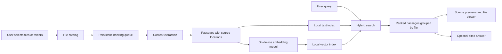
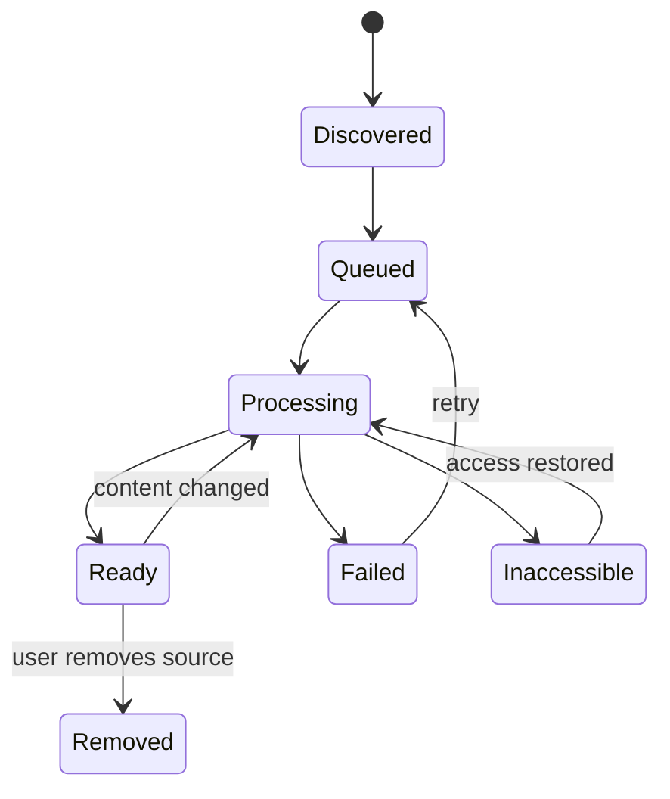

# PocketSearch

PocketSearch is a private, offline-capable search engine for personal files on Android. A user asks about a topic, and the app finds relevant passages across PDFs, documents, audio, and video without requiring the user to remember filenames.

Example:

> Find everything on my phone about AI agents.

Results should point to evidence:

| File | Relevant result | Open action |
| --- | --- | --- |
| `lecture_notes.pdf` | A section explaining agent memory | Open page 12 |
| `class_recording.mp3` | A discussion about tool calling | Play at 08:35 |
| `tutorial.mp4` | An explanation of multi-agent workflows | Play at 14:20 |
| `project_notes.txt` | Notes about LangGraph | Open the matching passage |

The app searches inside files first and can optionally answer from the retrieved content:

> Your files describe agents as systems that use models, tools, and memory. Here are three relevant sources.

Every claim must link to a page, passage, or timestamp. If evidence is missing, show:

> No relevant content found in your indexed files.

Never imply that inaccessible or unprocessed files were searched.

## Product direction

Launch with students and professionals who collect learning materials. Start with:

> Find the right passage in your PDFs without remembering the filename.

Make that fast and dependable before adding audio and video. The first architectural milestone is selecting 100 documents, indexing them locally, searching in airplane mode, and opening the correct source passage.

## MVP scope

- Android app
- User-selected files and folders
- Text PDFs, TXT, and Markdown
- Local text extraction, embeddings, and hybrid search
- Page and passage citations
- Background indexing with progress and resumability
- Search over files that are already indexed while new files process
- No backend required for search

The phone handles file discovery, extraction, embeddings, retrieval, and source previews. An answer engine is optional and can be added after retrieval is reliable.

## Architecture



Indexing and searching are independent pipelines. Files are prepared once in the background; searches retrieve from the indexed content immediately. The app must never parse thousands of files on every query.

## File access and discovery

Use Android's Storage Access Framework. Store the returned content URIs and persist permissions when the provider supports it. Also support individual file selection and **Share to PocketSearch**.

Android may restrict access to some locations, including selecting an entire Downloads directory on newer versions. The app must not assume unrestricted access to the phone.

The file catalog should record:

| Field | Purpose |
| --- | --- |
| `file_id` | Stable internal identifier |
| `source_uri` | Reference used to read and open the original |
| `display_name` | User-facing filename |
| `mime_type` | Selects the extractor |
| `size_bytes` | Estimates processing cost |
| `modified_at` | Cheap change-detection signal, when available |
| `content_hash` | Confirms content changes and detects duplicates |
| `active_revision` | Identifies the searchable version |
| `index_status` | `queued`, `processing`, `ready`, `failed`, or `inaccessible` |
| `error_code` | Explains failures and retry behavior |

Provider metadata can be incomplete. Treat timestamps and sizes as hints, and use content hashes when necessary.

## Background indexing

Use WorkManager for persistent, deferrable indexing with constraints such as adequate battery and charging for expensive work. It provides durable scheduling but not unlimited continuous execution, so long imports must respect Android execution limits.

Process files in bounded, checkpointed units:

```text
discover -> extract a page or media segment -> checkpoint -> chunk
         -> embed a small batch -> save -> continue
```

Required behavior:

- Index small text files first so users get value quickly.
- Use one embedding worker initially to limit memory pressure.
- Give interactive queries priority over background embedding.
- Pause expensive processing when the device is hot or low on battery.
- Resume from completed pages or media segments after interruption.
- Retry transient access errors.
- Expose password-protected and unsupported files clearly.
- Show progress such as `640 of 1,200 selected files searchable`.
- Keep already indexed files searchable throughout an import.

## Content extraction

All extractors return text plus a source location.

| Input | Extraction | Source location |
| --- | --- | --- |
| TXT / Markdown | Decode and normalize text | Character range |
| Text PDF | Extract text per page | Page and optional coordinates |
| Scanned PDF | Render pages, then OCR | Page and OCR bounding boxes |
| DOCX | Extract paragraphs and headings | Paragraph or section identifier |
| Audio | Speech transcription | Start and end timestamps |
| Video | Extract audio and transcribe | Start and end timestamps |
| Images | OCR visible text | Bounding boxes |
| Video visuals, later | Sample keyframes and compute visual embeddings | Frame timestamp |

Speech transcription does not capture silent diagrams or demonstrations. Visual video search therefore needs a separate visual pipeline. Keep the first release to text PDFs, TXT, and Markdown, then add extraction formats independently after retrieval works.

For Bangla OCR and speech, validate model coverage and accuracy on real samples before selecting an implementation. Do not assume an English-capable model supports Bangla well.

## Chunking and provenance

Split extracted content into passages suitable for embedding while preserving the source location.

Starting configuration:

- Approximately 250-400 tokens per passage
- 40-60 tokens of overlap
- Paragraph, heading, and sentence boundaries where possible
- Page boundaries and media timestamps retained
- Original text preserved for display
- A separate normalized representation used for search

Each chunk should include:

| Field | Example |
| --- | --- |
| `chunk_id` | Internal identifier |
| `file_id` / `file_revision` | Exact source version |
| `text` | Retrieved passage |
| `section_title` | `Agent memory` |
| `page_start` / `page_end` | PDF location |
| `start_ms` / `end_ms` | Media location |
| `char_start` / `char_end` | Text location |
| `extraction_version` | Parser, OCR, or transcriber version |
| `embedding_spec_id` | Compatible embedding configuration |

This provenance lets the app open page 12 or play at 08:35 instead of returning only a filename.

## On-device embeddings and storage

Start by benchmarking EmbeddingGemma 300M on a real Android device with a compatible LiteRT artifact. Test 256-dimensional embeddings against the full representation. Follow the model's query and document prefixes and re-normalize after dimension reduction.

| Storage | Stores |
| --- | --- |
| Room / SQLite | Catalog, chunks, indexing jobs, and model metadata |
| SQLite full-text index | Searchable passage text |
| Compact vector storage | Embeddings keyed by chunk ID |
| App-private files | Models, temporary extraction data, and index snapshots |

Keep original documents at their existing locations when possible. Copy only when necessary for processing, and disclose that behavior.

Start with exact vector search for a small corpus. Benchmark before introducing an approximate nearest-neighbor index. Index architecture should be chosen using passage counts, not file counts. For example, 100,000 passages at 256 dimensions and 4-byte values require about 102.4 MB for raw vectors before text, metadata, models, or index overhead.

Do not search old document vectors with a new, incompatible query encoder. Model upgrades require a separate index version and migration path.

## Query and ranking

For a query such as:

> Which files explain how AI agents remember previous conversations?

1. Apply explicit filters for file type, folder, date, or language.
2. Embed the query locally.
3. Retrieve semantic matches from the vector index.
4. Retrieve lexical matches from the text index.
5. Fuse rankings with reciprocal rank fusion.
6. Remove duplicate and heavily overlapping passages.
7. Group passages by file.
8. Return the best files with their strongest matching passages.

Start with 30-50 candidates from each retrieval path and return 5-10 grouped results. Tune these values through evaluation. Do not add lexical and cosine scores directly because they have different scales.

Rank files using the strongest passage plus a small contribution from additional distinct matches. A large book should not dominate only because it contains many chunks.

Example result:

```text
Agent Systems.pdf - Page 18
Long-term memory stores information across sessions.
[Open passage] [View other matches]
```

## Optional answer generation

Search and answer generation are separate capabilities.

| Mode | Behavior |
| --- | --- |
| Local search | Finds passages and files without internet |
| Local answer, later | A supported on-device LLM explains retrieved evidence |
| Cloud answer, optional | Sends the query and selected passages to a backend after opt-in |

Answer flow:

```text
retrieve evidence -> assign citation IDs -> generate answer
                  -> validate citation references -> display source links
```

Only selected passages should be sent for a cloud answer. Do not upload entire files by default. Citation-ID validation prevents broken links, but separate evaluation is still needed to verify that claims are actually supported.

Treat document content as untrusted evidence. The answer model must not execute instructions found inside a file.

## Updates, deletion, and recovery

Use versioned indexing so users never search a partially rebuilt file.



When a file changes:

1. Build new chunks and vectors under a new revision.
2. Keep the old revision searchable while processing.
3. Atomically switch the active revision.
4. Remove obsolete chunks and vectors.

When a source is removed, delete its derived text, vectors, previews, and cached answers. Exclude inaccessible files from normal results until access returns. Detect duplicates to avoid repeated results.

## Backend boundary

The first MVP needs no backend for search. Add one only for cloud answers, accounts, subscriptions, or synchronization.

| Component | Responsibility |
| --- | --- |
| FastAPI | Authentication, quotas, and optional answer requests |
| PostgreSQL | Accounts, subscription state, and consent/preferences |
| Model gateway | One selected generation provider initially |
| Object storage | Model distribution or explicitly enabled uploads |
| Telemetry | Aggregated performance and failure metrics |

Keep source documents, extracted text, vectors, and queries local by default. Cross-device synchronization needs explicit file transfer or a shared storage provider because a content URI from one phone does not identify an accessible file on another device.

## Roadmap

| Phase | Scope |
| --- | --- |
| First MVP | Android; user-selected text PDFs, TXT, and Markdown; local hybrid search; page citations |
| Second release | Scanned PDFs and images through OCR; incremental indexing |
| Third release | Audio and video speech transcripts with timestamped results |
| Advanced release | Visual video search, optional local answer generation, and cross-device synchronization |

## Build order and checks

| Stage | Deliverable | Check |
| --- | --- | --- |
| 1 | Physical-device embedding spike | Measure latency, memory, and model loading |
| 2 | PDF/TXT ingestion with provenance | Every passage maps to its source |
| 3 | Lexical and dense retrieval | Compare results against labeled queries |
| 4 | Android results and source viewer | Open the correct page or passage |
| 5 | Persistent indexing and revisions | Kill the app mid-import and resume correctly |
| 6 | Incremental updates and deletion | No stale or deleted results |
| 7 | Optional cited answers | Test missing evidence and false citations |
| 8 | OCR, then audio/video | Evaluate extraction errors separately |

## Product principles

- Private and offline by default.
- Evidence before answers.
- Search indexed content only, and show indexing status.
- Index once and process only new or changed files.
- Let users pause, resume, and delete derived data.
- Keep the search experience centered on one search box, file-type filters, indexing progress, and source previews.
- Optimize for passage relevance and dependable source opening before adding more modalities.

## Seven-day MVP structure

Use this proposed Flutter and Android structure for the seven-day MVP. These paths describe the intended architecture; files should be created as each milestone is implemented. Keep Flutter-generated build files and directories as created by the tooling. Add background worker files only when that milestone is implemented.

```text
pocketsearch/
  pubspec.yaml
  README.md

  lib/
    main.dart
    app.dart

    models/
      source_file.dart
      document_chunk.dart
      search_result.dart
      index_progress.dart
      embedding_spec.dart

    storage/
      local_database.dart
      file_store.dart
      chunk_store.dart
      vector_store.dart

    indexing/
      file_importer.dart
      text_extractor.dart
      chunker.dart
      indexer.dart

    search/
      search_engine.dart
      keyword_search.dart
      vector_search.dart
      rank_fusion.dart

    platform/
      native_bridge.dart

    screens/
      search_screen.dart
      sources_screen.dart
      passage_screen.dart
      settings_screen.dart

    widgets/
      search_result_card.dart
      indexing_progress.dart

  android/
    app/
      src/
        main/
          AndroidManifest.xml
          kotlin/
            com/
              example/
                pocketsearch/
                  MainActivity.kt
                  NativeBridge.kt
                  EmbeddingEngine.kt
                  DocumentAccess.kt
                  PdfExtractor.kt

  assets/
    fixtures/
      sample.txt

  test/
    chunker_test.dart
    rank_fusion_test.dart
    vector_search_test.dart

  integration_test/
    offline_search_test.dart

  benchmark/
    queries.jsonl
    relevance.jsonl
    results.csv

  docs/
    architecture.md
    benchmark.md
    limitations.md
```

### Main file responsibilities

| File | Responsibility |
| --- | --- |
| `main.dart` | Initialize dependencies and start the app |
| `app.dart` | Theme and navigation |
| `local_database.dart` | SQLite connection, schema, migrations, and transactions |
| `file_store.dart` | Imported sources, permission metadata, and revisions |
| `chunk_store.dart` | Passage text, locations, and full-text search records |
| `vector_store.dart` | Embeddings and their compatible specification |
| `file_importer.dart` | Register selected sources and queue indexing |
| `text_extractor.dart` | Read TXT/Markdown and delegate PDF extraction |
| `chunker.dart` | Split content while preserving provenance |
| `indexer.dart` | Coordinate extraction, embedding, and publication |
| `search_engine.dart` | Combine retrieval paths and group matches by file |
| `native_bridge.dart` | Dart-facing wrapper around native calls |
| `EmbeddingEngine.kt` | Load the model, tokenize, infer, and normalize |
| `DocumentAccess.kt` | Read content URIs and retain supported permissions |
| `PdfExtractor.kt` | Extract page-aware text |

### Database ownership

Use one database owner. For the first version, Dart owns the database; native code returns extraction and inference results. Dart and Kotlin must not maintain independent implementations that update the same indexing state.

### Native bridge

Keep the native bridge small:

| Operation | Input | Output |
| --- | --- | --- |
| `initializeEmbedding` | Model artifact location and configuration | Loaded model specification |
| `embedQuery` | Query text | Normalized vector |
| `embedDocuments` | Small batch of titled passages | Normalized vectors |
| `readSource` | Content URI | Bounded text or bytes |
| `extractPdfPage` | Content URI and page number | Text and source location |
| `openSource` | Content URI | Success or structured error |
| `disposeEmbedding` | None | Completion |

Run extraction and inference on native worker threads. An asynchronous channel call alone does not move expensive work off the native main thread.

Transfer text and compact vectors across the bridge instead of repeatedly transferring whole PDFs. Keep the model loaded during active indexing and search, and serialize inference initially unless the runtime explicitly supports concurrent use.

### Indexing flow

1. `sources_screen.dart` requests file selection.
2. `file_importer.dart` registers source URIs.
3. `indexer.dart` loads the next queued source.
4. `text_extractor.dart` extracts bounded content.
5. `chunker.dart` creates passages with page or character locations.
6. `native_bridge.dart` requests document embeddings.
7. The stores save passages and vectors.
8. A transaction publishes the completed revision.
9. The screen observes saved progress.

For the fastest first version, indexing can run while the app is open and resume from durable progress after reopening. This is resumable indexing, not guaranteed background execution. Completing work while the application is closed requires a properly integrated background execution path; do not assume a Dart isolate survives application termination.

### Search flow

1. The user submits a query.
2. `search_engine.dart` requests a query embedding.
3. Keyword search and vector search retrieve candidates.
4. `rank_fusion.dart` combines their rankings.
5. The engine removes overlap and groups passages by file.
6. Results display the filename, preview, and source location.
7. The passage screen opens the matching evidence.

Run CPU-intensive vector scanning in a Dart isolate once measurements show it affects responsiveness. Keep queries and corpus vectors on the same embedding specification.
